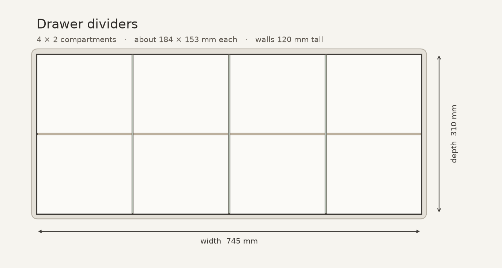
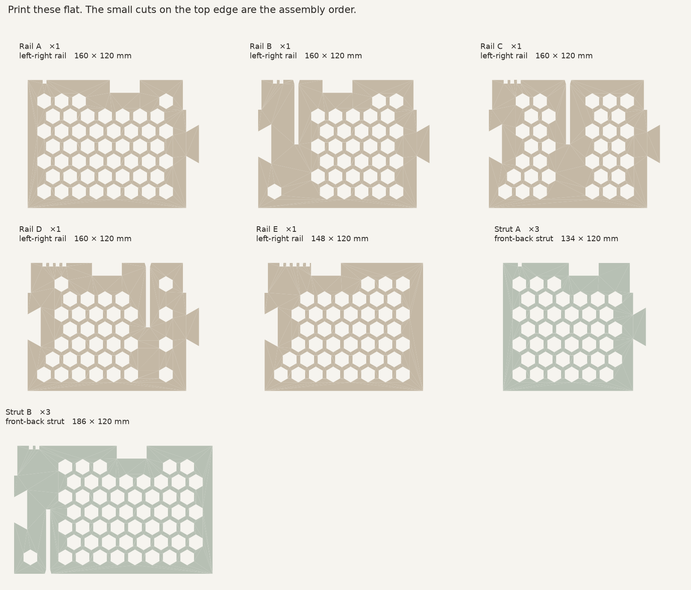
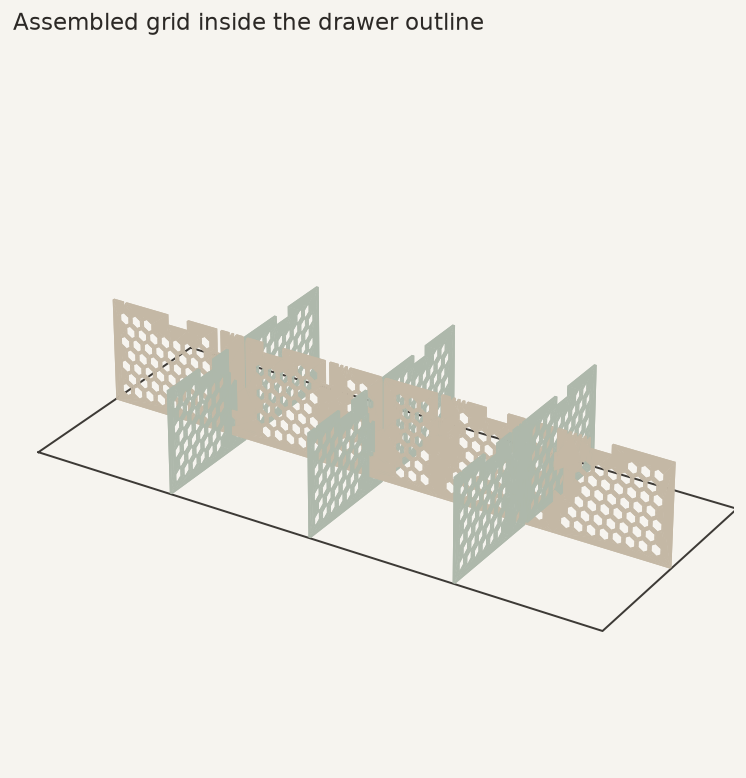

# Drawer dividers

A PLA grid for a drawer that measures **745 × 310 × 140 mm** inside (width × depth × height). Printed on a Bambu Lab P2S.

The layout is **4 compartments across and 2 front to back**. Each opening is about **184 × 153 mm**. The walls are **120 mm** tall, which leaves 20 mm of the drawer height free so you can grab what is inside.

The walls are honeycomb so they stay stiff without using a full sheet of plastic. Long walls are split into pieces that fit the 256 mm bed. Rails (left to right) drop onto struts (front to back) with half-lap slots. Pieces in a straight line lock with a dovetail and a small pin.

## What to print

About **504 g of PLA** for the whole grid, plus a short test plate. One spool is enough.

| Part | Copies | Size on the bed | PLA each |
| --- | ---: | --- | ---: |
| Rail A | 1 | 160 × 120 × 3.2 mm | 43 g |
| Rail B | 1 | 160 × 120 × 3.2 mm | 49 g |
| Rail C | 1 | 160 × 120 × 3.2 mm | 50 g |
| Rail D | 1 | 160 × 120 × 3.2 mm | 48 g |
| Rail E | 1 | 148 × 120 × 3.2 mm | 42 g |
| Strut A | 3 | 134 × 120 × 3.2 mm | 36 g |
| Strut B | 3 | 186 × 120 × 3.2 mm | 54 g |
| Pin | 7 | 24 × 6 × 3.0 mm | 0.5 g |

Small cuts in the top edge are the assembly order: one cut on the first piece, then two, then three, counting up. Rails go left to right in letter order. Struts go front to back, A in front of B. Print **3 of each strut**.

## Plates

Open **`drawer_dividers.3mf`** in Bambu Studio. Every part is already on its own plate, and the file uses the **0.20 mm Standard** PLA profile for a 0.4 mm nozzle.

- **Test fit** — Test rail, Test strut, Test joint A, Test joint B, Test pin
- **Plate 2** — Strut B #1, Strut B #2, Pin 1, Pin 2
- **Plate 3** — Strut B #3, Rail B, Pin 3, Pin 4, Pin 5, Pin 6
- **Plate 4** — Rail D, Rail A, Pin 7
- **Plate 5** — Rail C, Rail E
- **Plate 6** — Strut A #1, Strut A #2
- **Plate 7** — Strut A #3

Print **Test fit** first. The two long bars should slide together to half height and sit flush. The dovetail should press together through the thickness, and the pin should drop in from the top with firm finger pressure. If a joint is too tight to assemble, stop and do not print the rest — the fit needs a little more clearance.

## Slicer settings

- Printer: Bambu Lab P2S, 0.4 mm nozzle
- Material: PLA. Use the Bambu PLA preset (or your PLA's temperatures).
- Layer height: **0.20 mm**. The wall is 3.2 mm thick, which is exactly 16 layers. Do not switch to 0.24 mm; the thickness would no longer match the slots.
- Walls: 3. Infill: 100%. The honeycomb is already in the model, and the wall is only 3.2 mm thick.
- Supports: off. Brim: off. The parts lie flat and have a large first layer.
- Leave the parts in the orientation they load. The honeycomb face is the top.

## Assembly

1. Join the rail left to right in letter order (A, then B, then C, and so on). Press each dovetail together sideways, then drop a pin into the hole at the top of the joint. The pin sits a few millimetres below the top.
2. Join each strut front to back the same way. You need three struts.
3. Lay the rail down with the slots facing up.
4. Slide the three struts down onto the rail, slots facing down, until the tops are level. The wide mouth on each slot is the lead-in.
5. Drop the grid into the drawer. It is 1 mm short of each wall so it goes in without forcing.

The drawer walls are the outer sides of the compartments. The printed grid is the cross in the middle.

## If you want a different grid

The numbers at the top of `generate.py` are the drawer size, the compartment counts, and the wall height. Change them and run `python3 generate.py`. Keep `WALL_H` at 110 mm or more so the pin stays clear of the dovetail, and keep each piece under about 220 mm so the dovetail still fits the bed.

This is an original layout for these drawer measurements. The honeycomb-and-split-wall idea follows the same practical approach as the customizable IKEA BROR divider on MakerWorld: light walls, little filament, and pieces you can adjust to the drawer you actually have.
