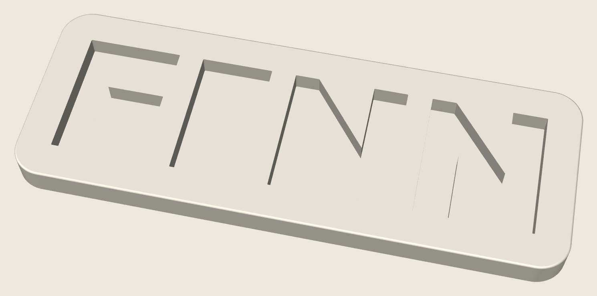
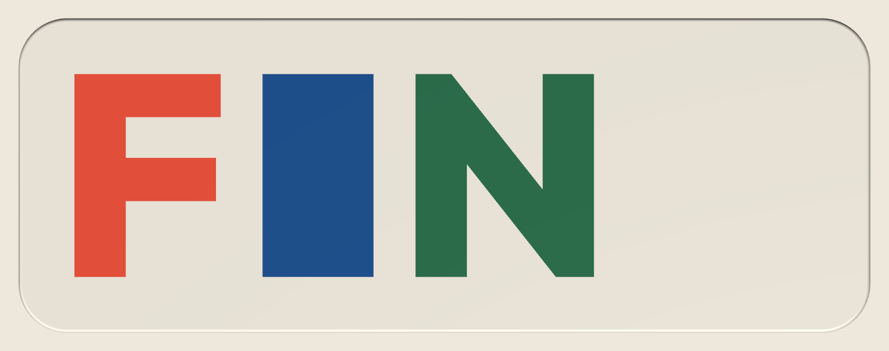

# FINN name puzzle

A name puzzle for a Bambu Lab P2S. The letters are a clean geometric sans, on a low board with soft corners. Each slot is the outline of that letter, so the F only fits the F hole and an N only fits an N hole.




## Print this

The P2S build volume is 256 × 256 × 256 mm. The board is **244 × 90 × 13.5 mm**, so it fits on the bed with a few millimetres to spare. Center it if the slicer does not.

Use a **0.4 mm nozzle** and **PLA**. Matte bone for the board and solid colors for the letters match the shapes. The printer has one nozzle, so print each color on its own plate. That avoids an AMS and the wasted filament from color changes.

| Piece | File | Suggested PLA | How many |
| --- | --- | --- | --- |
| Board | `stl/finn_board.stl` | Bone, ivory, or warm white | 1 |
| F | `stl/finn_letter_F.stl` | Coral or red | 1 |
| I | `stl/finn_letter_I.stl` | Navy | 1 |
| N | `stl/finn_letter_N.stl` | Forest green | 1 |
| N | `stl/finn_letter_N.stl` | Gold or yellow | 1 |

The two N pieces are the same shape. Print that file twice.

`finn_name_puzzle.3mf` has all five pieces laid out as separate objects with those colors. Open it in Bambu Studio if you want them on one plate. Printing several colors in one job needs an AMS and spends a lot of filament on purges, so separate plates are the better default.

### On the bed

- **Board:** flat, slots facing up. No supports.
- **Letters:** flat, either face down. Both faces are flat. No supports and no brim.

### Bambu Studio settings

Start from the Generic PLA preset for the P2S, then use:

- Layer height **0.20 mm** (0.16 mm if you want smoother sides on the letters)
- Walls **4**
- Infill **15% gyroid**
- Top and bottom shells **5**
- Ironing **on**, top surfaces only, so the letter faces look smooth
- Supports **off**
- Brim **off**
- Elephant foot compensation **0.10 mm**
- Seam position **back**

### Fit

Each hole is that letter, **0.40 mm** larger on every side. That is the gap a 0.4 mm nozzle needs so the piece still drops in. The walls follow the letter, including the open side of the F and the diagonal of the N. F will not go in the I or N holes. Either N fits either N hole. Each letter sits about **4 mm** above the board, so it can be pinched out.

`finn_name_puzzle.3mf` is a closed mesh. Bambu Studio should import it without an open-edge warning.

If a piece feels tight, scale **that letter** to 99% in the slicer. Leave the board at 100%.

## Sizes

| Piece | Size (mm) |
| --- | --- |
| Board | 244.2 × 90.4 × 13.5 |
| F | 41.9 × 58.4 × 13.0 |
| I | 31.9 × 58.4 × 13.0 |
| N | 51.2 × 58.4 × 13.0 |

The slots are 9 mm deep. The letters are 13 mm thick.



These pieces are large for a toddler toy. The smallest letter is about 32 mm wide and 58 mm tall. Supervise play the way you would with any small child's toy.

## Regenerating the files

```bash
pip install -r requirements.txt
python3 generate.py
```

The F and N come from [Outfit ExtraBold](https://fonts.google.com/specimen/Outfit) by the Outfit Project Authors, included under the SIL Open Font License (`fonts/OFL.txt`). The I is a wider bar of the same height so a child can hold it. The script only builds the name FINN.
