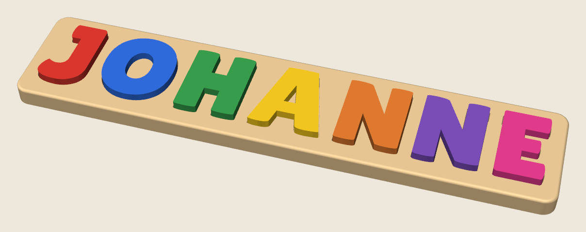
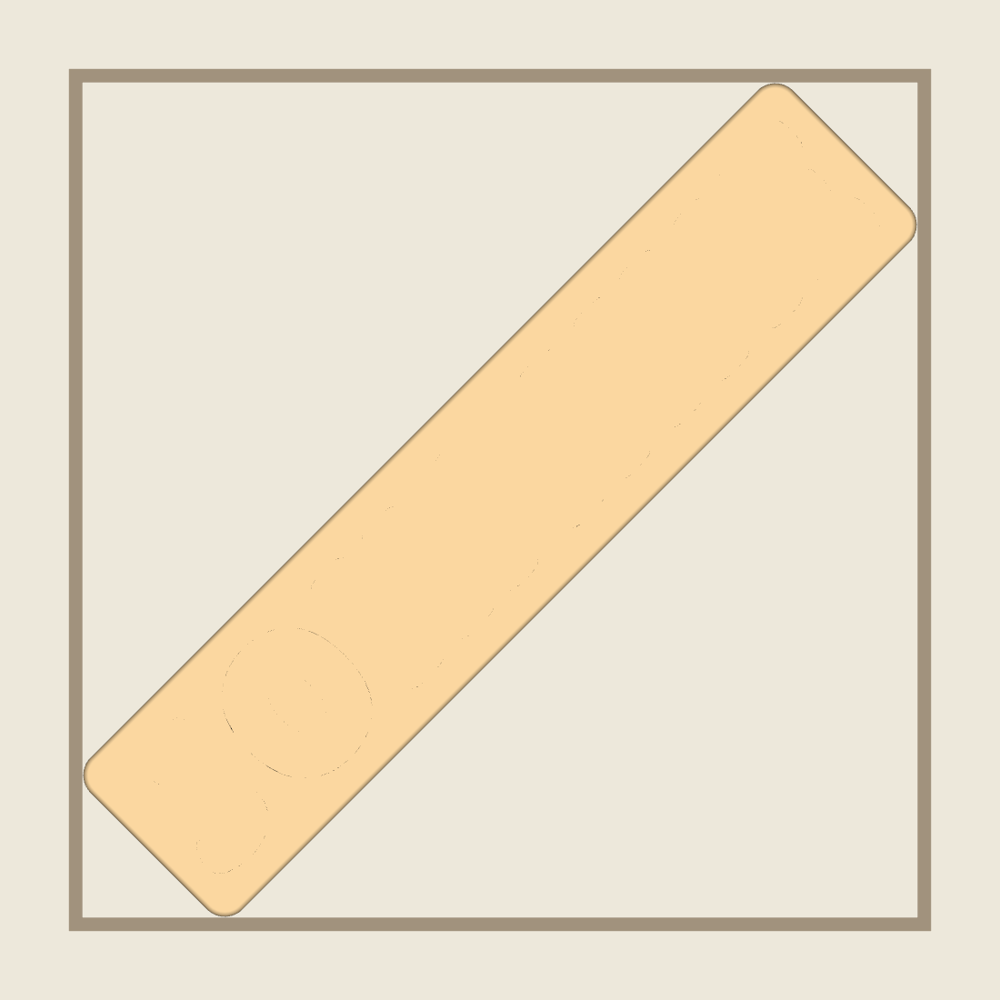
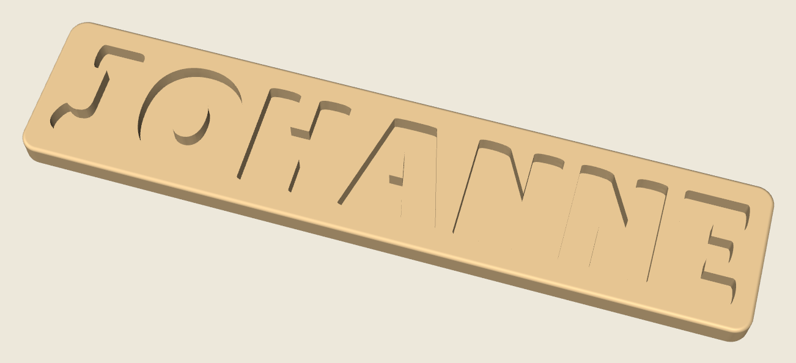
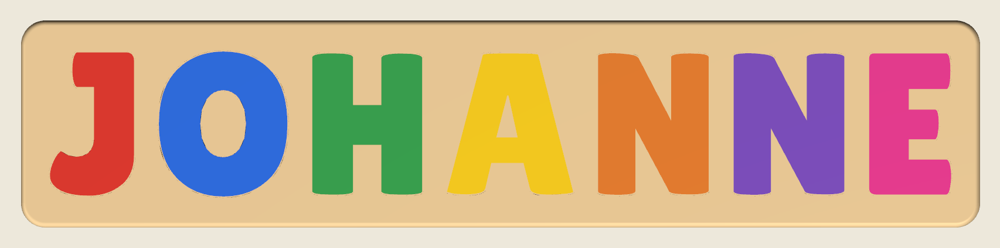
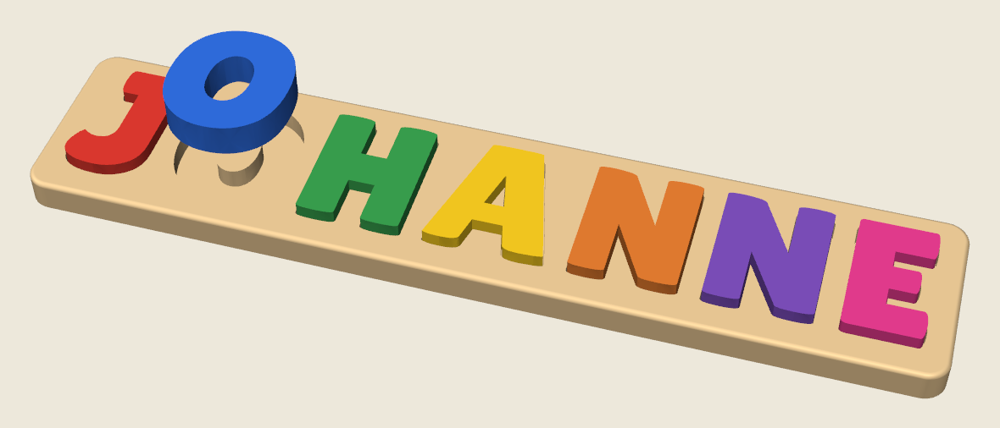

# JOHANNE name puzzle

A name puzzle for a Bambu Lab P2S. The board is one solid piece. Each slot is that letter's outline, so the O only fits the O hole and either N fits either N hole.

The name is longer than the 256 mm bed. Turned 45 degrees, the board can be **295 mm** long instead of 247.5 mm, because the spare depth of the bed takes the width of the board. The 3MF already has the board turned on plate 1.







## Print this

[Download johanne_name_puzzle.3mf](johanne_name_puzzle.3mf). It is a Bambu Studio project for a **Bambu Lab P2S with a 0.4 mm nozzle**. Plate 1 is the board, already turned 45 degrees. Plate 2 is the letters. The file does not change the extruder type or the filament start G-code.

The straight STL of the board is longer than the bed. Use the 3MF, or turn that STL 45 degrees yourself and center it. There is about 4 mm of bed left outside the turned board.

| Piece | File | Suggested PLA |
| --- | --- | --- |
| Board | `stl/johanne_board.stl` | Tan `#E8C794` |
| J | `stl/johanne_letter_J_1.stl` | Red `#DB382E` |
| O | `stl/johanne_letter_O_2.stl` | Blue `#2E6BDB` |
| H | `stl/johanne_letter_H_3.stl` | Green `#389E4D` |
| A | `stl/johanne_letter_A_4.stl` | Yellow `#F2C71F` |
| N | `stl/johanne_letter_N_5.stl` | Orange `#E07A2F` |
| N | `stl/johanne_letter_N_6.stl` | Purple `#7A4DB8` |
| E | `stl/johanne_letter_E_7.stl` | Pink `#E23B8C` |

The two N pieces are the same shape. Either one fits either N hole.

### On the bed

- **Board:** the 3MF has it flat, slots up, turned 45 degrees. No supports and no brim.
- **Letters:** flat, one color per plate. No supports and no brim.

### Bambu Studio settings

The 3MF selects the P2S 0.4 mm nozzle and 0.20 mm Standard. For the board:

- Layer height **0.20 mm**
- Walls **3**
- Infill **15% grid**
- Top and bottom shells **9** each, so the 3.5 mm floor stays solid
- Ironing **off**
- Supports **off**
- Brim **off**
- Elephant foot compensation **0.10 mm**
- Seam position **back**

### Fit

Each hole is that letter, **0.40 mm** larger on every side. O and A keep their counters, so the board has a matching island. The letters are 11 mm thick and sit about 4 mm above the board.

J is 26 × 44 × 11 mm and E is 25 × 44 × 11 mm. Both can drop through the printer's small-parts opening. Keep an eye on them as the print starts.

If a piece feels tight, scale **that letter** to 99%. Leave the board at 100%.

## Sizes

| Piece | Size (mm) |
| --- | --- |
| Board | 295.0 × 63.9 × 10.5 |
| Bed footprint, turned 45° | 247.5 × 247.5 |
| J | 25.9 × 44.2 × 11.0 |
| O | 39.5 × 44.7 × 11.0 |
| H | 33.8 × 43.6 × 11.0 |
| A | 38.8 × 43.6 × 11.0 |
| N | 34.1 × 43.6 × 11.0 |
| E | 25.2 × 43.5 × 11.0 |

The wood between letters is 6.8 mm. Straight on the bed, the same letters would have to shrink until the board was 247.5 mm long.





## Regenerating the files

```bash
python3 generate.py
```

The letter shapes come from [Lilita One](fonts/OFL.txt) by Juan Montoreano, included under the SIL Open Font License.
