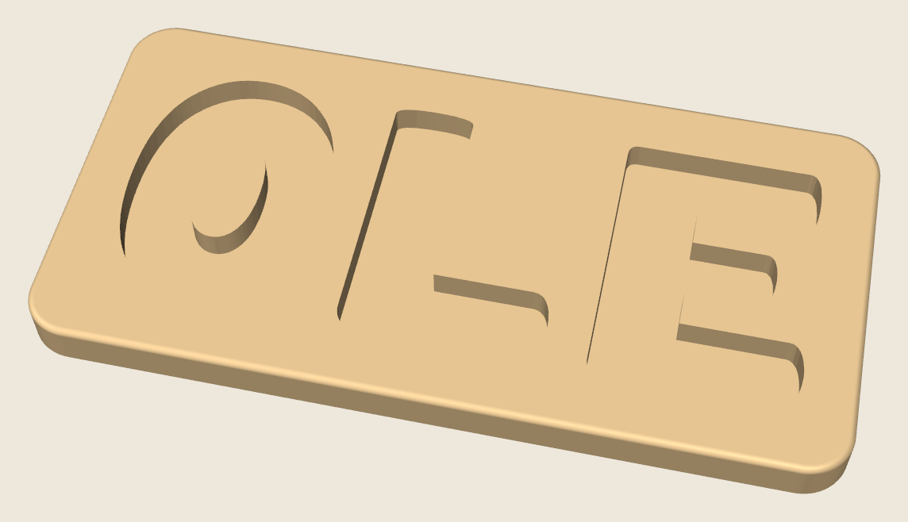
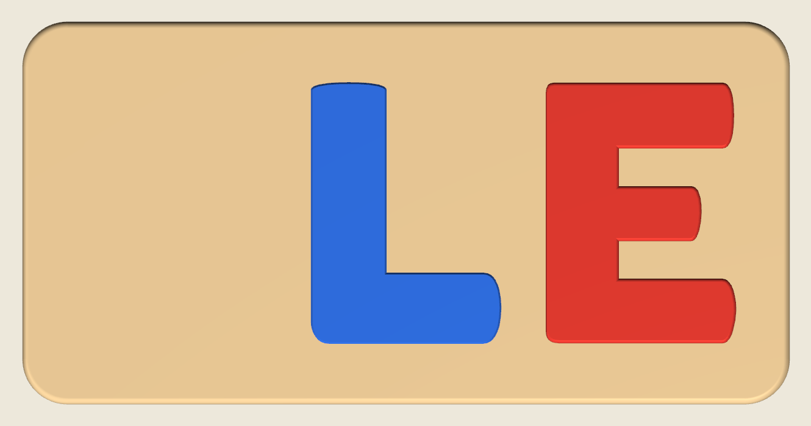

# OLE name puzzle

A name puzzle for a Bambu Lab P2S, in the same chunky wooden style as the FINN board. The letters are the same size as the printed FINN letters. OLE is three letters, so the board is one piece.




## Print this

The P2S build volume is 256 × 256 × 256 mm. The board is **186.8 × 93.3 × 10.5 mm**, so it fits on the bed with room to spare. Center it if the slicer does not.

Use a **0.4 mm nozzle** and **PLA**. A matte or wood-tone PLA looks the most like a painted board. The printer has one nozzle, so print each color on its own plate.

| Piece | File | Suggested PLA | How many |
| --- | --- | --- | --- |
| Board | `stl/ole_board.stl` | Tan, beige, or wood | 1 |
| O | `stl/ole_letter_O.stl` | Orange | 1 |
| L | `stl/ole_letter_L.stl` | Blue | 1 |
| E | `stl/ole_letter_E.stl` | Red | 1 |

`ole_name_puzzle.3mf` is a Bambu Studio project for the **Bambu Lab P2S, 0.4 mm nozzle**, using the **0.20 mm Standard** process and four **PLA Basic** slots (tan, orange, blue, red). The board and the three letters are separate objects on one plate. Printing several colors in one job needs an AMS, so separate plates are the better default.

### On the bed

- **Board:** flat, slots facing up. No supports.
- **Letters:** flat. The broader flat face goes on the build plate. No supports and no brim.

### Bambu Studio settings

The 3MF already selects the P2S 0.4 mm nozzle and 0.20 mm Standard. If you start from the STL files instead:

- Layer height **0.20 mm** (0.16 mm for smoother letter sides)
- Walls **4**
- Infill **15% gyroid**
- **Board:** top shells **9** and bottom shells **9**. The floor is 3.5 mm, and 9 × 0.20 mm covers it, so the floor prints solid. The rim still has gyroid in the middle.
- **Letters:** top and bottom shells **5** are enough
- Ironing **on**, top surfaces only
- Supports **off**
- Brim **off**
- Elephant foot compensation **0.10 mm**
- Seam position **back**

### Fit

Each hole is that letter, **0.40 mm** larger on every side. There is **10 mm** of wood between O and L, and the same between L and E. O keeps its hole, and the board has an island in that counter with the same 0.40 mm gap. O only fits the O hole, and the same is true for L and E. Each letter sits about **4 mm** above the board.

O, L, and E are the same width, **46.4 mm**, halfway between the natural O (58 mm) and the natural L (35 mm). The O is squeezed sideways, so it is an oval and keeps its hole. L and E get there by a longer foot and longer arms. Their uprights stay the original thickness.

The meshes are closed. Bambu Studio should not ask you to repair open edges, and it should not warn that `extruder_type` was replaced.

If a letter feels tight, scale **that letter** to 99%. Leave the board at 100%.

## Sizes

| Piece | Size (mm) |
| --- | --- |
| Board | 186.8 × 93.3 × 10.5 |
| O | 46.4 × 65.3 × 11.0 |
| L | 46.4 × 63.8 × 11.0 |
| E | 46.4 × 63.6 × 11.0 |

The slots are 7 mm deep. The letters are 11 mm thick. The board floor is 3.5 mm. The letters are the same height as the printed FINN puzzle. The shared width is halfway between the natural O and the natural L.



These pieces are large for a toddler toy. Each letter is about 46 mm wide and 64 mm tall. Supervise play the way you would with any small child's toy.

## Regenerating the files

```bash
pip install -r requirements.txt
python3 generate.py
```

The letter shapes come from [Lilita One](https://fonts.google.com/specimen/Lilita+One) by Juan Montoreano, included under the SIL Open Font License (`fonts/OFL.txt`).
