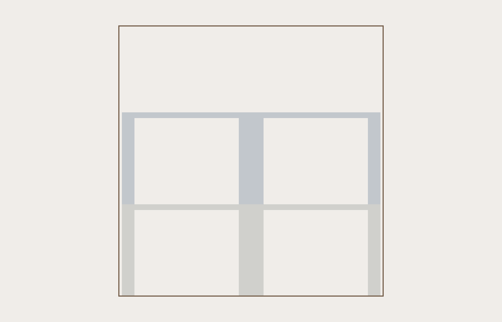
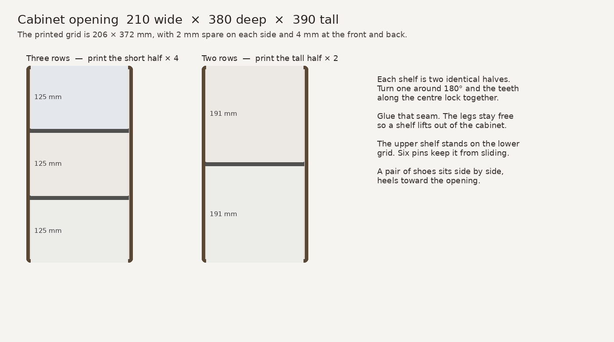
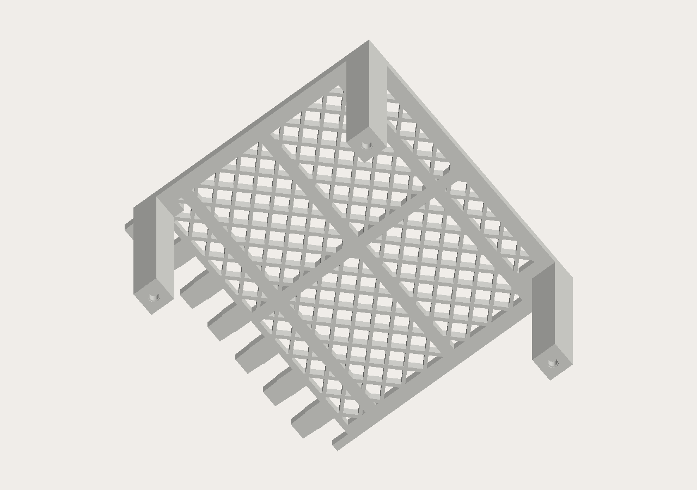
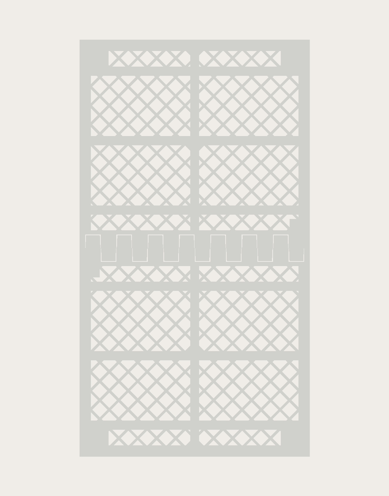

# Lattice shoe shelf

A shoe shelf for the inside of a cabinet opening **210 mm wide, 380 mm deep, and 390 mm tall**. The grid sits on legs, the same kind of insert as a printed cabinet shoe shelf, sized for this opening and split so it fits a Bambu Lab P2S.





The printed shelf is **206 × 372 mm**. That leaves 2 mm of spare on each side and 4 mm at the front and back, so it can slide in. A pair of shoes sits side by side, heels toward the opening. The holes in the grid are about 10 mm across, small enough that a normal heel stays on top.

## Which version

Measure one shoe standing on a table, from the table to the highest point of the shoe.

| Your shoes | Print | Shoe rows | Clear height |
| --- | --- | --- | --- |
| Up to about 120 mm (flats, low sneakers) | `shelf_half_3row.stl` × 4, plus the pins | 3 | 125 mm |
| Taller shoes, boots, high-tops | `shelf_half_2row.stl` × 2 | 2 | 191 mm |

The three-row shelf is two grids stacked in the cabinet. The two-row shelf is a single taller grid. Both leave the bottom row sitting on the cabinet floor.





## Print this

The P2S bed is 256 × 256 × 256 mm. One half is **206 × 198 mm**, and the tall version is **199 mm** high, so each half is one plate. Nothing about this shelf prints in one piece.

Use a **0.4 mm nozzle** and **PLA**.

| Piece | File | How many |
| --- | --- | --- |
| Short half (3 rows) | `stl/shelf_half_3row.stl` | 4 |
| Tall half (2 rows) | `stl/shelf_half_2row.stl` | 2 |
| Pins (3 rows only) | `stl/pins.stl` | 1 plate, 8 pins, use 6 |

`shoe_shelf_3row.3mf` and `shoe_shelf_2row.3mf` are Bambu Studio projects for the **Bambu Lab P2S, 0.4 mm nozzle, PLA**. The half is already on the bed with the grid down. The three-row project also has the pins. Print that plate four times for the halves, and keep the pins from only one of those plates.

### On the bed

The flat grid goes on the build plate. The legs point up. The comb teeth are on one edge. No supports and no brim.

If the slicer turns the part onto its side, lay it back down. A leg or a tooth on the bed will not print cleanly.

### Bambu Studio settings

The 3MF selects the P2S and the 0.20 mm Standard profile. Change these before slicing:

- Layer height **0.20 mm**
- Walls **4**
- Infill **15% gyroid**
- Top and bottom layers **4**
- Supports **off**
- Brim **off**
- Elephant foot compensation **0.10 mm**

The legs are hollow tubes. Four walls make the 3.2 mm tube solid. The grid ribs are 2.4 mm, so they print as walls.

A short half is about 300 g of PLA. Four of them need a full kilogram spool. A tall half is about 350 g, so the two-row shelf is about 700 g.

## Put it together

1. Take two halves that are the same height. Lay both with the legs pointing the same way.
2. Turn one half around 180° in the plane. Do not flip it over. The teeth on one half drop into the slots on the other.
3. Glue the teeth with cyanoacrylate. Keep the two grids flat on the table, with a book on top, until the glue holds. The legs are not glued to anything.
4. For the three-row shelf, press six pins into the holes in the **feet** of the upper shelf. Leave the lower shelf's feet empty so it sits flat on the cabinet floor. The pin plate has eight pins, so two are spares.
5. Put the lower shelf in the cabinet, legs down, grid up.
6. Set the upper shelf on it. The pins drop into the holes in the lower grid, and the feet land on the solid pads at the corners and at the middle of each side.

The two shelves are not glued together. Lift the top one out to reach the shoes underneath.

If a pin will not enter a foot, scale **the pin file** to 98% and print it again. If a pin is loose, a drop of glue in the foot hole holds it. If the teeth will not close, do not force them; sand the tight tooth. If the finished shelf is tight in the cabinet, scale both halves of that shelf to 99% and print them again. Scale both, so the teeth still match.

## Sizes

| | 3 rows | 2 rows |
| --- | --- | --- |
| Cabinet opening | 210 × 380 × 390 mm | same |
| Shelf footprint | 206 × 372 mm | same |
| One half on the printer | 206 × 198 × 133 mm | 206 × 198 × 199 mm |
| Clear height, each row | 125 mm | 191 mm |
| Top of the upper grid | 265 mm | 199 mm |

## Regenerating the files

The dimensions at the top of `generate.py` are the cabinet opening. Change those and run:

```bash
pip install -r requirements.txt
python3 generate.py
```

Each half has to stay under 250 mm in every direction so it still fits the P2S. A deeper opening than about 480 mm, or a wider one than about 250 mm, will not fit this split.
