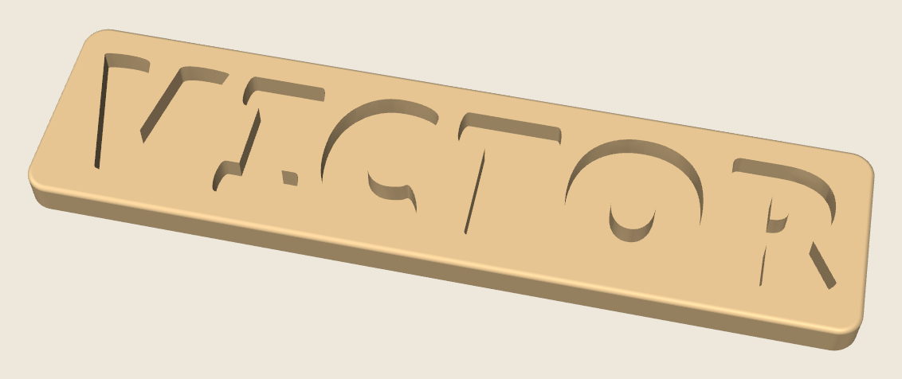
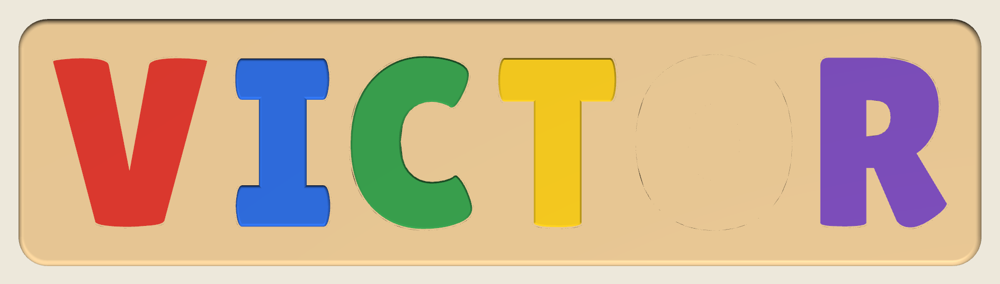

# VICTOR name puzzle

A name puzzle for a Bambu Lab P2S, in the same chunky wooden style as the FINN board. The board is one solid piece. The row is scaled so it fits the 256 mm bed with a few millimetres to spare. The wood between every letter is the same.


## Print this

Use a **0.4 mm nozzle** and **PLA**. A matte or wood-tone PLA looks the most like a painted board. The printer has one nozzle, so print each color on its own plate.

| Piece | File | Suggested PLA | How many |
| --- | --- | --- | --- |
| Board | `stl/victor_board.stl` | Tan, beige, or wood | 1 |
| V | `stl/victor_letter_V.stl` | Red | 1 |
| I | `stl/victor_letter_I.stl` | Blue | 1 |
| C | `stl/victor_letter_C.stl` | Green | 1 |
| T | `stl/victor_letter_T.stl` | Yellow | 1 |
| O | `stl/victor_letter_O.stl` | Orange | 1 |
| R | `stl/victor_letter_R.stl` | Purple | 1 |

`victor_name_puzzle.3mf` is a Bambu Studio project for the **Bambu Lab P2S, 0.4 mm nozzle**, using the **0.20 mm Standard** process and seven **PLA Basic** slots (tan, red, blue, green, yellow, orange, purple). Plate 1 is the board. Plate 2 is the letters. The letters are different colors. Separate letter plates avoid an AMS and the purge waste.

### On the bed

- **Board:** flat, slots facing up. No supports. It is already centered on plate 1.
- **Letters:** flat, one color at a time unless you have an AMS. The broader flat face goes on the build plate. No supports and no brim.

### Bambu Studio settings

The 3MF already selects the P2S 0.4 mm nozzle and 0.20 mm Standard. If you start from the STL files instead:

- Layer height **0.20 mm** (0.16 mm for smoother letter sides)
- Walls **4**
- Infill **15% gyroid**
- **Board:** top shells **9** and bottom shells **9**. The floor is 3.5 mm, and 9 × 0.20 mm covers it, so the floor prints solid. The rim still has gyroid in the middle.
- **Letters:** top and bottom shells **5** are enough
- Ironing **on**, top surfaces only
- Supports **off**
- Brim **off**
- Elephant foot compensation **0.10 mm**
- Seam position **back**

### Fit

Each hole is that letter, **0.40 mm** larger on every side. O and R keep their holes, and the board has an island that fills the counter with the same 0.40 mm gap. V only fits the V hole, and the same is true for the other letters. Each letter sits about **4 mm** above the board.

The meshes are closed. Bambu Studio should not ask you to repair open edges, and it should not warn that `extruder_type` was replaced.

If a letter feels tight, scale **that letter** to 99%. Leave the board at 100%.

## Sizes

The board is **247.5 × 63.7 × 10.5 mm**.

| Piece | Size (mm) |
| --- | --- |
| Board | 247.5 × 63.7 × 10.5 |
| V | 39.6 × 43.5 × 11.0 |
| I | 24.4 × 43.4 × 11.0 |
| C | 31.2 × 44.6 × 11.0 |
| T | 30.3 × 43.7 × 11.0 |
| O | 39.4 × 44.6 × 11.0 |
| R | 32.6 × 43.8 × 11.0 |

The slots are 7 mm deep. The letters are 11 mm thick. The board floor is 3.5 mm. There is 6.8 mm of wood between every pair of letters.





The **I** is 24.4 × 43.4 × 11.0 mm. That fits a small-parts cylinder (31.7 mm across and 57.1 mm deep), so it is small for a toddler. The other letters are wider than that opening. Supervise play the way you would with any small child's toy.

## Regenerating the files

```bash
pip install -r requirements.txt
python3 generate.py
```

The letter shapes come from [Lilita One](https://fonts.google.com/specimen/Lilita+One) by Juan Montoreano, included under the SIL Open Font License (`fonts/OFL.txt`).
