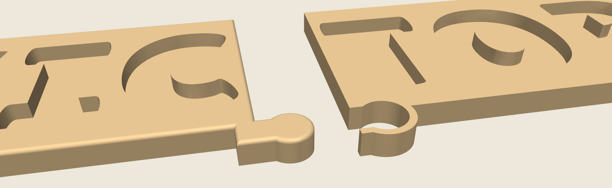

# VICTOR name puzzle

A name puzzle for a Bambu Lab P2S, in the same chunky wooden style as the FINN board. The letters are the same size as the printed FINN letters. The board is one long row, split into two pieces. The wood between every letter is the same. The key hangs on the bottom edge, under the seam between C and T, so that pair is not pushed apart.




## Why it is two pieces

VICTOR in one row, at this letter size, is about **361 mm** long. The P2S bed is 256 mm. A single-piece board only fits if the letters shrink to about two thirds. At that size the I is about 24 × 43 mm and can pass a small-parts cylinder (31.7 mm across and 57.1 mm deep), which is too small for a toddler toy.

The full-size letters stay. The board is printed as **VIC** and **TOR**. Each half fits on the bed with room to spare. There is 10 mm of wood between every pair of letters, including C and T. The VIC piece has a round key on the bottom edge. The TOR piece has the matching socket. The neck of the key is narrower than the round end, so the halves cannot pull apart sideways. They slide together from above.

A few drops of plastic glue (CA) along the seam and inside the key make it one board a child can pick up. Without glue it still sits as one puzzle on the table, but one half can slide upward if the board is lifted by the other end. Glue is the right finish. The key is there so the halves line up and the joint is stronger than a flat butt glue.

## Print this

Use a **0.4 mm nozzle** and **PLA**. A matte or wood-tone PLA looks the most like a painted board. The printer has one nozzle, so print each color on its own plate.

| Piece | File | Suggested PLA | How many |
| --- | --- | --- | --- |
| Board VIC | `stl/victor_board_vic.stl` | Tan, beige, or wood | 1 |
| Board TOR | `stl/victor_board_tor.stl` | Same tan as VIC | 1 |
| V | `stl/victor_letter_V.stl` | Red | 1 |
| I | `stl/victor_letter_I.stl` | Blue | 1 |
| C | `stl/victor_letter_C.stl` | Green | 1 |
| T | `stl/victor_letter_T.stl` | Yellow | 1 |
| O | `stl/victor_letter_O.stl` | Orange | 1 |
| R | `stl/victor_letter_R.stl` | Purple | 1 |

`victor_name_puzzle.3mf` is a Bambu Studio project for the **Bambu Lab P2S, 0.4 mm nozzle**, using the **0.20 mm Standard** process and seven **PLA Basic** slots (tan, red, blue, green, yellow, orange, purple). Plate 1 is the two board halves. Plate 2 is the letters. Both boards are the same color, so plate 1 can print in one job. The letters are different colors. Separate letter plates avoid an AMS and the purge waste.

### On the bed

- **Boards:** flat, slots facing up. No supports. The two halves are already placed on plate 1 with a gap between them. They are the same filament, so the normal layer-by-layer sequence is right. Do not turn on print-by-object for this plate.
- **Letters:** flat, one color at a time unless you have an AMS. The broader flat face goes on the build plate. No supports and no brim.

### Joining the board

1. Test-fit the key with no glue. VIC's key slides down into TOR's socket. The top faces should land flush.
2. If it is tight, the usual cause is the first-layer squish. Elephant foot compensation of **0.10 mm** is enough. Do not scale the boards.
3. Put a thin bead of CA on the straight seam and around the key. Slide them together on a flat table. Wipe the squeeze-out. Keep the board flat until the glue holds.

### Bambu Studio settings

The 3MF already selects the P2S 0.4 mm nozzle and 0.20 mm Standard. If you start from the STL files instead:

- Layer height **0.20 mm** (0.16 mm for smoother letter sides)
- Walls **4**
- Infill **15% gyroid**
- **Board pieces:** top shells **9** and bottom shells **9**. The floor is 3.5 mm, and 9 × 0.20 mm covers it, so the floor prints solid. The rim still has gyroid in the middle.
- **Letters:** top and bottom shells **5** are enough
- Ironing **on**, top surfaces only
- Supports **off**
- Brim **off**
- Elephant foot compensation **0.10 mm**
- Seam position **back**

### Fit

Each hole is that letter, **0.40 mm** larger on every side. O and R keep their holes, and the board has an island that fills the counter with the same 0.40 mm gap. V only fits the V hole, and the same is true for the other letters. Each letter sits about **4 mm** above the board.

The meshes are closed. Bambu Studio should not ask you to repair open edges, and it should not warn that `extruder_type` was replaced.

If a letter feels tight, scale **that letter** to 99%. Leave both board pieces at 100%.

## Sizes

The two pieces together are one board of **360.8 × 93.3 × 10.5 mm**. The key hangs below that rectangle, so the printed pieces are a little deeper. Printed separately:

| Piece | Size (mm) |
| --- | --- |
| Board VIC | 195.9 × 106.1 × 10.5 |
| Board TOR | 185.6 × 109.4 × 10.5 |
| V | 58.1 × 63.8 × 11.0 |
| I | 35.8 × 63.6 × 11.0 |
| C | 45.8 × 65.3 × 11.0 |
| T | 44.4 × 64.0 × 11.0 |
| O | 57.8 × 65.3 × 11.0 |
| R | 47.7 × 64.2 × 11.0 |

The slots are 7 mm deep. The letters are 11 mm thick. The board floor is 3.5 mm. There is 10 mm of wood between every pair of letters. The key is 18 mm across at the round end and 13 mm across at the neck.


These pieces are large for a toddler toy. The smallest letter is still about 36 mm wide and 64 mm tall. Supervise play the way you would with any small child's toy.

## Regenerating the files

```bash
pip install -r requirements.txt
python3 generate.py
```

The letter shapes come from [Lilita One](https://fonts.google.com/specimen/Lilita+One) by Juan Montoreano, included under the SIL Open Font License (`fonts/OFL.txt`).
